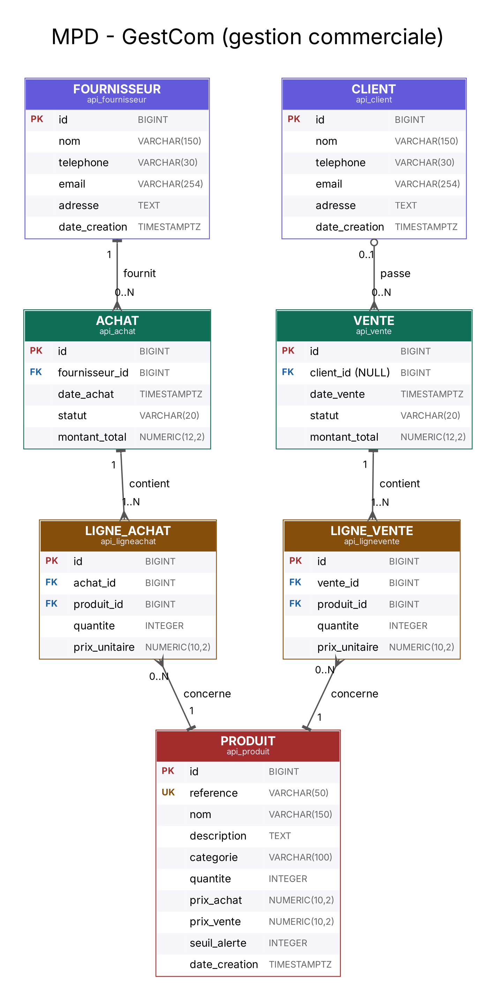

# GestCom - Gestion commerciale

Application web de gestion commerciale (produits et stocks, clients, fournisseurs, achats, ventes).

- Backend : Django et Django REST Framework (dossier `api` et `backend`)
- Frontend : React avec Vite (dossier `frontend`)

## Modèle physique de données (MPD)

